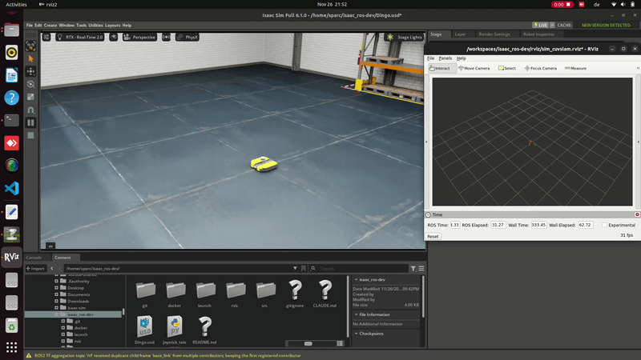

# Isaac ROS with Isaac Sim on a Clearpath Dingo: Tutorial 2 (cuVSLAM)

Launch file and scripts for tutorial 2 of the Isaac ROS series on [SPARC Lab](https://www.youtube.com/@SPARCLab07).
Isaac Sim 6.1 + Isaac ROS 3.2 (ROS 2 Humble).

## Setup

```
# clone this branch as your Isaac ROS workspace
git clone -b tutorial-2 https://github.com/sahilrajpurkar03/isaac_ros-dev.git ~/isaac_ros-dev
export ISAAC_ROS_WS=~/isaac_ros-dev

# src/ is not in this repo, clone NVIDIA's isaac_ros_common into it (Isaac ROS 3.2)
mkdir -p ${ISAAC_ROS_WS}/src && cd ${ISAAC_ROS_WS}/src
git clone -b release-3.2 https://github.com/NVIDIA-ISAAC-ROS/isaac_ros_common.git
```

Then follow the tutorial on the [SPARC Lab YouTube channel](https://www.youtube.com/@SPARCLab07).

## Output

**cuVSLAM: visual odometry and sparse 3D map**



## Contents

| Path | What it is |
|---|---|
| `tutorial-2-instructions.txt` | step by step commands for tutorial 2 (cuVSLAM) |
| `launch/sim_cuvslam.launch.py` | cuVSLAM (stereo) on the Isaac Sim cameras |
| `joystick_teleop.py` | drive the robot with a joystick (`/cmd_vel`) |
| `Dingo.usd` | Isaac Sim scene |
